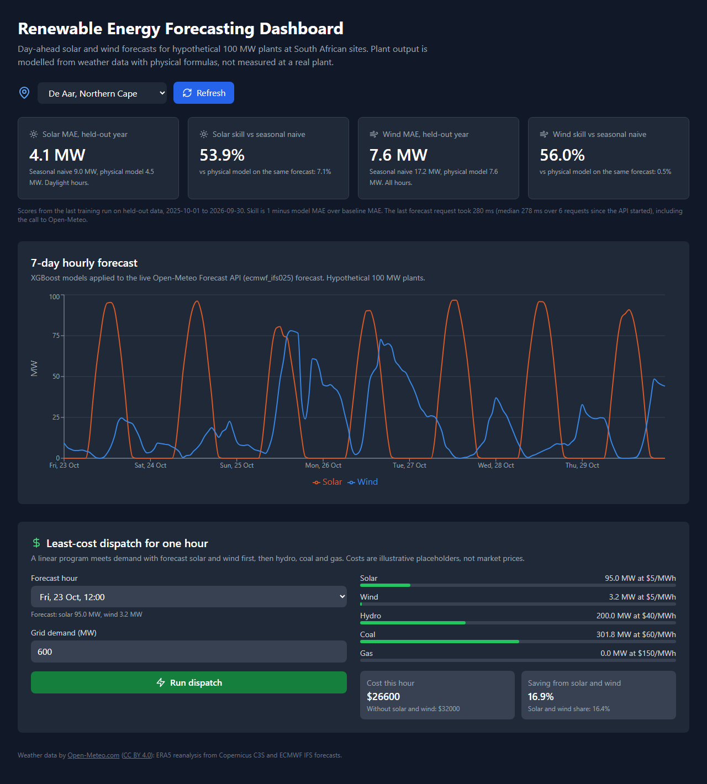
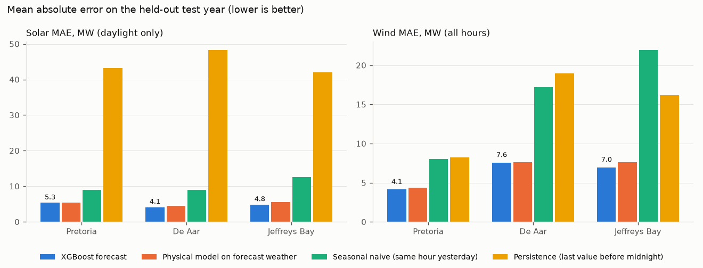
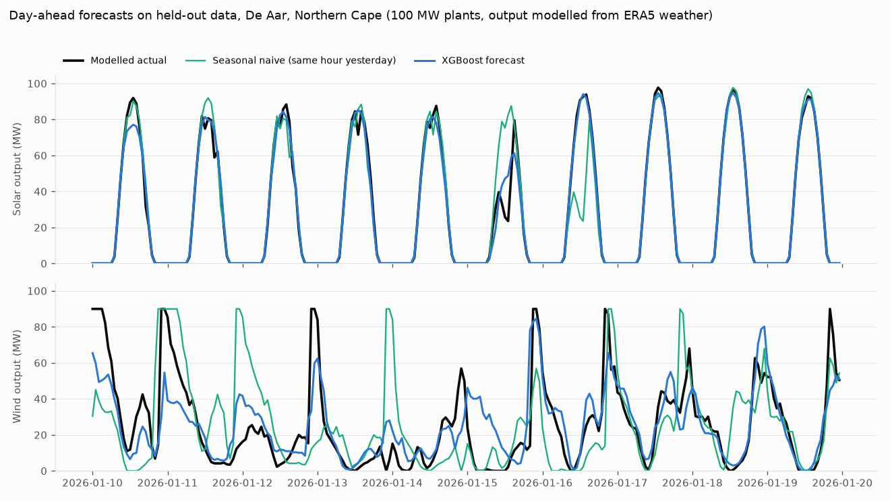

# Renewable Energy Forecasting Dashboard

Day-ahead forecasts of solar and wind output for three South African sites (Pretoria, De Aar and Jeffreys Bay), served by a FastAPI backend and shown on a React dashboard with a small least-cost dispatch demo. It is a portfolio project for people who want to see a forecasting pipeline evaluated honestly: time-based split, naive baselines and a physical-model baseline.

**The plant output is modelled, not measured.** Each site has a hypothetical 100 MW PV plant and 100 MW wind farm. Their "actual" output comes from ERA5 reanalysis weather run through documented physical models (pvlib PVWatts for PV, a generic turbine power curve for wind). No real plant data is used.



## Results

Test period: 1 October 2025 to 30 September 2026, a full year the model never saw. The model's inputs are the ECMWF forecasts that were issued 24 hours before each hour, so it only sees what a forecaster would have had. Errors are in MW for a 100 MW plant, so 1 MW is 1% of capacity. Solar is scored on daylight hours only (13,245 hours over three sites; mean output 44.6 MW). Wind is scored on all hours (26,280 hours; mean output 15.0 MW).

| Method | Solar MAE | Solar RMSE | Wind MAE | Wind RMSE |
|---|---|---|---|---|
| XGBoost on day-ahead forecast weather | **4.77** | **7.84** | **6.22** | **10.09** |
| Physical model on the same forecast weather (no ML) | 5.13 | 8.05 | 6.53 | 11.65 |
| Seasonal naive (same hour yesterday) | 10.17 | 16.92 | 15.74 | 25.18 |
| Persistence (value at 23:00, held for the next day) | 44.55 | 53.32 | 14.46 | 23.36 |

Skill (1 minus model MAE over baseline MAE):

| Baseline | Solar | Wind |
|---|---|---|
| Physical model on forecast weather | 6.9% | 4.8% |
| Seasonal naive | 53.1% | 60.5% |
| Persistence | 89.3% | 57.0% |

What this means:

- Most of the gain over the naive baselines comes from the weather forecast itself. Plugging the forecast into the physical model already cuts the seasonal-naive error by half or more.
- XGBoost adds a little on top: 6.9% lower MAE for solar and 4.8% for wind. For wind it cuts RMSE by 13.3%, so it helps most on large misses.
- The gain is not the same everywhere. For solar at Pretoria the model barely beats the physical model (MAE 5.34 vs 5.37), and at De Aar its solar RMSE is slightly worse (7.23 vs 7.19). For wind at De Aar the MAE gain is 0.5% (7.56 vs 7.60).
- Persistence is a weak baseline for solar by design: at midnight the last value is zero.

Per site, MAE in MW (model / physical / seasonal naive / persistence):

| Site | Solar | Wind |
|---|---|---|
| Pretoria, Gauteng | 5.34 / 5.37 / 8.98 / 43.24 | 4.14 / 4.34 / 8.06 / 8.23 |
| De Aar, Northern Cape | 4.14 / 4.45 / 8.98 / 48.34 | 7.56 / 7.60 / 17.21 / 18.98 |
| Jeffreys Bay, Eastern Cape | 4.85 / 5.56 / 12.54 / 42.07 | 6.95 / 7.65 / 21.97 / 16.19 |



Ten days of held-out forecasts at De Aar:



All numbers come from `python run_training.py` and are saved in [docs/metrics.json](docs/metrics.json). Training is deterministic; two runs gave the same scores.

### A lesson from the first attempt

My first run used Open-Meteo's default `best_match` forecast source. The model then lost to the physical baseline (wind MAE 7.49 vs 5.50). In every test month the model over-forecast wind by 0.4 to 5.6 MW on average, while the physical model stayed within 1.8 MW. The likely cause: Open-Meteo's archive of the newer 9 km ECMWF model starts in autumn 2025, and after that the `best_match` wind forecasts were less biased against ERA5 than in the training period. The model kept correcting a bias that had shrunk. Pinning one model (ECMWF IFS 0.25°) for training, testing and the live forecast fixed it.

I made that change after seeing the test-year result, so the test scores above may be a little optimistic. A cleaner check would choose the weather source on a validation period before the test year.

### Speed

In one local run the first forecast request took 8.7 s (cold start). Later 7-day requests took about 0.28 s, nearly all of it the call to Open-Meteo; the two model predictions took under 20 ms. The dashboard shows the request times the running API has measured, not fixed numbers.

## How it works

```
Open-Meteo Historical Weather API (ERA5)  --> physical PV and wind models --> modelled "actual" output (target)
Open-Meteo Previous Runs API (ECMWF IFS,  --> features                    --> XGBoost, one model each for solar and wind
  forecast made 24 h before each hour)
Open-Meteo Forecast API (same IFS model)  --> same features               --> live 7-day forecast on the dashboard
```

1. **Data** (`backend/data_processing/ingestion.py`): hourly GHI, DNI, diffuse radiation, temperature, cloud cover, and wind at 10 m and 100 m, from 1 April 2024 (when the 100 m day-ahead archive starts) to 30 September 2026.
2. **Modelled output** (`power_model.py`): PV is a fixed-tilt array facing north at latitude tilt, 120 MW DC on 100 MW AC, with NREL SPA solar position, isotropic plane-of-array irradiance, Faiman cell temperature, PVWatts DC (-0.4%/°C) and inverter models, and 14% system losses. Wind uses 100 m wind speed and a generic curve: cut-in 3 m/s, cubic ramp to rated output at 12 m/s, cut-out 25 m/s, 10% farm losses.
3. **Features** (`feature_engineering.py`): forecast weather, 3-hour centred means of forecast radiation and wind, wind direction, hour and day of year as sine and cosine, sun elevation, site latitude and longitude, and the physical models applied to the forecast weather. No feature uses plant output.
4. **Split** (`ml/train.py`): train April 2024 to June 2025, early-stopping validation July to September 2025, test October 2025 to September 2026. No random split, no shuffling.
5. **Baselines** (`ml/baselines.py`): a forecast issued at midnight for the next 24 hours. Persistence holds the value at 23:00 the day before; seasonal naive uses the same hour the day before. The physical model on forecast weather is the no-ML reference.
6. **API** (`backend/api/main.py`): `GET /locations`, `POST /forecast`, `POST /optimize`, `GET /metrics` (held-out scores plus measured request times), `GET /health`. Docs at `/docs`.
7. **Dispatch demo** (`optimization/cost_optimizer.py`): a one-hour linear program (PuLP and CBC) that meets demand from forecast solar and wind, then hydro, coal and gas. The costs (USD/MWh: solar 5, wind 5, hydro 40, coal 60, gas 150) are placeholders, not market data. The saving it reports is against the same dispatch without solar and wind.

## How to run

Tested on Windows 11 with Python 3.12 and Node 22.

```bash
# Backend
cd backend
python -m venv .venv
source .venv/bin/activate          # Windows: .venv\Scripts\activate
pip install -r requirements.txt

python run_initialization.py       # downloads weather data (about 5 minutes), builds data/processed/dataset.csv
python run_training.py             # trains both models (about 15 seconds), writes data/models/ and docs/ figures
uvicorn api.main:app --port 8000   # API at http://localhost:8000/docs

# Frontend, in a second terminal
cd frontend
npm ci
npm run dev                        # dashboard at http://localhost:5173
```

The frontend calls `http://localhost:8000` by default; set `VITE_API_URL` to change it. Downloads are cached in `data/raw/`; use `python run_initialization.py --refresh` to fetch again.

Tests (offline, synthetic data), from the repository root with the backend environment active:

```bash
pytest
```

## Data source and licence

- Weather data by [Open-Meteo.com](https://open-meteo.com/), licensed [CC BY 4.0](https://creativecommons.org/licenses/by/4.0/). Downloaded 23 October 2026.
  - Historical Weather API, model `era5`: ERA5 reanalysis from the Copernicus Climate Change Service (C3S).
  - Previous Runs API and Forecast API, model `ecmwf_ifs025`: ECMWF IFS open data forecasts.
- The free Open-Meteo API is meant for non-commercial use.
- Downloaded data (about 8 MB) and the built dataset (about 22 MB) are not in git. `run_initialization.py` fetches them again.
- Code: MIT licence, see [LICENSE](LICENSE).

## Limits and next steps

- **Modelled output.** The scores show how well a day-ahead forecast plus ML predicts ERA5-driven modelled output. Real plants add outages, curtailment, soiling, trackers and direction-dependent wake losses, so real errors would be larger. Next step: train on measured generation, for example Eskom's hourly wind and PV data, after checking its licence.
- **Low wind output.** ERA5 100 m wind with a generic power curve gives mean output of 15 MW per 100 MW overall and 7 MW at Pretoria, below what South African wind farms report.
- **Lead time.** The model is tested only on forecasts made 24 hours ahead. The dashboard shows up to 7 days; days 2 to 7 will be less accurate, and I have not measured by how much.
- **One split.** One test year and no uncertainty bands. Next: rolling-origin evaluation and quantile forecasts.
- **Simple dispatch.** One hour at a time, placeholder costs, no ramp limits, reserves or network.
- **No scheduler.** Rerun the two scripts to refresh data and models. An earlier Airflow DAG was removed because it called the broken pipeline and was never run.

### What changed from the first version

The first version reported 100% accuracy for solar and 97% for wind. Those numbers came from leakage and are gone:

- Features were built from the target: `radiation_efficiency` divided solar output by radiation, and rolling means of output included the current hour.
- Hourly rows were split at random, so test hours sat between training hours.
- "Accuracy" counted any prediction within 15% plus 1 MW as correct.
- The live forecast filled the output-lag features with zeros, so served predictions did not match training.
- The historical weather URL returned 404, and wind speeds in km/h were treated as m/s.
- Latency, uptime, prediction counts and the 35% cost saving were typed into the code and README.
- The frontend did not compile and the tests failed.

## Author

Tiiso Letsapa, Letsapamyron07@gmail.com
